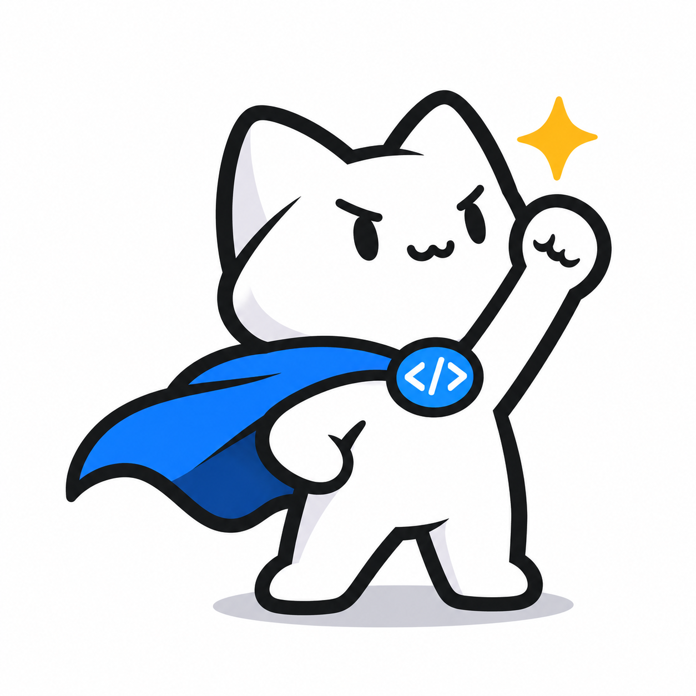

<h1></h1>

백준 문제 옆에서 코드를 작성하고 로컬에서 테스트하는 Chrome 확장 프로그램입니다. 확인한 제출의 소스와 채점 결과를 보관하고, 연결한 GitHub 저장소에 동기화할 수 있습니다. 현재 Pre-alpha 버전입니다.

- <a href="#소스에서-설치하기"> 소스에서 설치</a>
- <a href="#사용-방법"> 사용 방법</a>
- <a href="docs/GIT_SYNC.md"> GitHub 연결</a>
- <a href="#검증-방법"> 설치 확인</a>

## 소스에서 설치하기

Chrome 116 이상, Node.js 24 이상, `package.json`에 지정된 pnpm이 필요합니다.

```sh
pnpm install --frozen-lockfile
pnpm build
```

1. Chrome에서 `chrome://extensions`를 열고 **개발자 모드**를 켭니다.
2. **압축해제된 확장 프로그램을 로드합니다**를 선택하고 `apps/extension/.output/chrome-mv3`를 지정합니다. macOS에서 `.output`이 보이지 않으면 **⌘ + ⇧ + .**을 누릅니다.
3. 로컬 테스트, 제출 연결, GitHub 동기화를 사용하려면 로컬 연결 도구를 설치합니다. 소스 빌드에는 Rust stable이 필요합니다. 설치 후 패널의 **설정**에서 **로컬 실행** 항목의 **연결 테스트**를 누릅니다. [운영체제별 설치](docs/INSTALLATION.md)

## 사용 방법

1. **초안 작성.** 백준 문제 페이지에서 SUPER_BOJ 아이콘을 누릅니다. **에디터**에서 언어를 선택하고 코드를 입력하면 초안이 자동으로 저장됩니다.
2. **로컬 테스트.** 에디터의 **전체 실행**을 누르면 오른쪽 패널에 케이스별 결과가 표시됩니다. **테스트 케이스** 탭에서 예제와 사용자 입력을 개별 실행할 수 있습니다. 선택한 언어의 컴파일러나 인터프리터가 필요합니다. 실행 코드는 사용자 계정 권한으로 동작하므로 직접 작성하고 신뢰하는 코드만 실행합니다. 지원 범위와 실행 권한은 [언어 프로필](docs/decisions/0007-language-profiles.md)과 [보안 문서](docs/SECURITY.md)를 참고합니다.
3. **제출과 이력 연결.** 문제 페이지에서 에디터의 **공식 제출** 아이콘을 누르면 코드를 복사하고 공식 제출 페이지를 엽니다. 같은 언어를 선택하고 코드를 붙여넣어 직접 제출합니다. 제출 전에 로컬 연결을 설정하면 준비 기록도 저장됩니다. 백준 채점 현황을 연 뒤 에디터의 **제출 기록 연결**에서 내 제출 행과 준비 기록을 선택하고, 공식 제출 코드를 붙여넣어 확인합니다. C11, C++17, Python 3, Java 11, Rust 2021의 기록을 연결할 수 있습니다. [백준 제출 연동](docs/BOJ_INTEGRATION.md)
4. **GitHub 동기화.** **GitHub**에서 저장소 주소와 브랜치를 지정하거나, 로그인 기능이 켜진 빌드에서는 **GitHub로 연결**로 저장소를 선택합니다. 자동 동기화는 동의한 뒤 활성화됩니다. 공개 저장소와 동기화하면 소스와 메타데이터가 공개됩니다. [GitHub 연결과 인증](docs/GIT_SYNC.md)

## 검증 방법

Apple Silicon macOS의 Chrome for Testing에서 확장과 로컬 연결 도구가 통신하고 코드를 실행하는 것을 확인했습니다. 제출별 보존과 동기화 복구는 자동화 테스트로 확인했습니다. 공식 백준 계정에서의 제출과 이력 연결, 앱의 실제 GitHub 자동 푸시, Windows·Linux 실행은 이번 검증 범위에 포함되지 않았습니다. [기술 검증 기록](docs/FEASIBILITY.md)

아래 로컬 검증용 코드를 패널에 붙여넣고 **사용자 테스트 실행**을 누릅니다. 입력에 `1 2`, 예상 출력에 `3`을 넣으면 실제 출력에 `3`과 함께 `PASSED`가 표시되어야 합니다. 백준 제출이나 GitHub 연결 없이 이 검증을 수행할 수 있습니다.

```rust
use std::io::{self, Read};

fn main() {
    let mut input = String::new();
    io::stdin().read_to_string(&mut input).unwrap();
    let mut numbers = input.split_whitespace().map(|n| n.parse::<i32>().unwrap());
    println!("{}", numbers.next().unwrap() + numbers.next().unwrap());
}
```

터미널에서는 같은 코드를 `main.rs`로 저장해 다음처럼 확인할 수 있습니다.

```sh
cargo run --locked -- doctor
printf '1 2\n' | cargo run --locked -- run main.rs
```

저장소 전체를 검증하려면 아래 명령을 실행합니다.

```sh
cargo fmt --all -- --check
cargo clippy --locked --workspace --all-targets -- -D warnings
cargo test --locked --workspace
cargo build --locked
pnpm install --frozen-lockfile
pnpm typecheck
pnpm lint
pnpm test
pnpm build
```

## 개발

- [아키텍처](docs/ARCHITECTURE.md)
- [빌드와 테스트](docs/DEVELOPMENT.md)
- [기술 검증 기록](docs/FEASIBILITY.md)
- [IPC 프로토콜](docs/IPC_PROTOCOL.md)
- [기여 안내](CONTRIBUTING.md)
- [MIT 라이선스](LICENSE)

<p></p>

바로가기에 [theSVG 아웃라인 아이콘](https://thesvg.org/ui)을, 확장 GitHub 화면에 [theSVG GitHub 로고](https://thesvg.org/icon/github)를 사용합니다. [MIT 라이선스](docs/images/icons/LICENSE)
