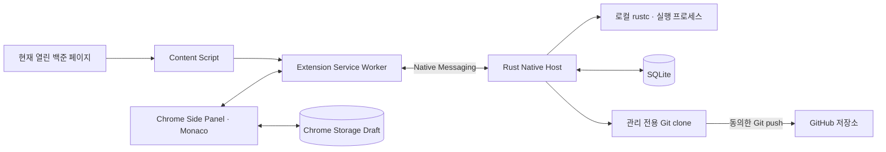

# 아키텍처

SUPER_BOJ는 Chrome Manifest V3 확장과 사용자의 운영체제 계정에서 실행되는 Rust Native Host로 구성됩니다. Chrome은 `com.superboj.core`를 필요할 때 실행하고 stdin/stdout으로 프레임을 교환합니다. Rust Core에는 HTTP 서버와 수신 포트가 없습니다.

Content Script는 페이지 컨텍스트를 읽습니다. Service Worker는 브라우저 메시지 발신자와 데이터 형태를 확인하고 확장 화면의 Native 요청을 중계합니다. Draft는 확장의 저장소에, 제출 스냅샷과 동기화 상태는 Native 저장소에 영속화합니다.

사용자가 실행을 요청하면 Core가 임시 디렉터리에 소스를 기록하고 셸 없이 `rustc`를 호출합니다. 테스트 모음은 컴파일 결과 하나를 공유하며 각 입력은 새 실행 프로세스로 전달합니다.

[실행 및 보안 범위](SECURITY.md) · [프로토콜](IPC_PROTOCOL.md) · [백준 연동](BOJ_INTEGRATION.md) · [동기화](GIT_SYNC.md)
